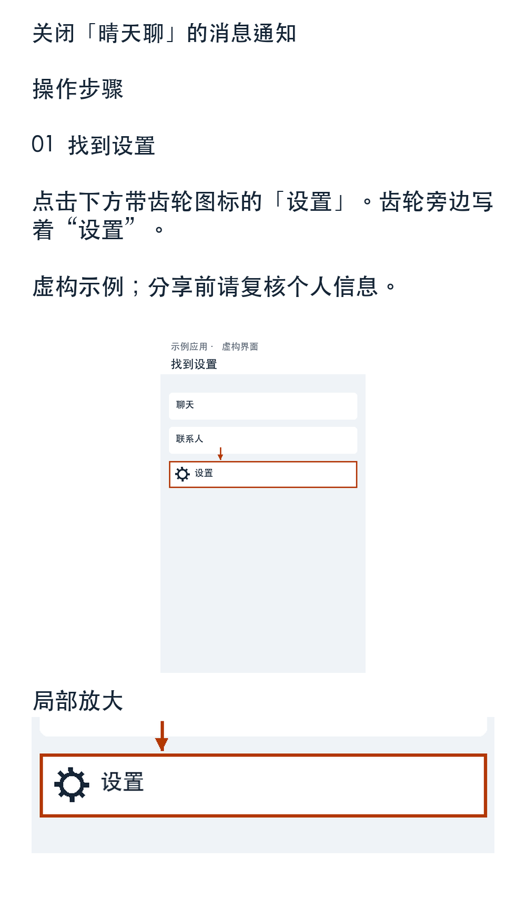
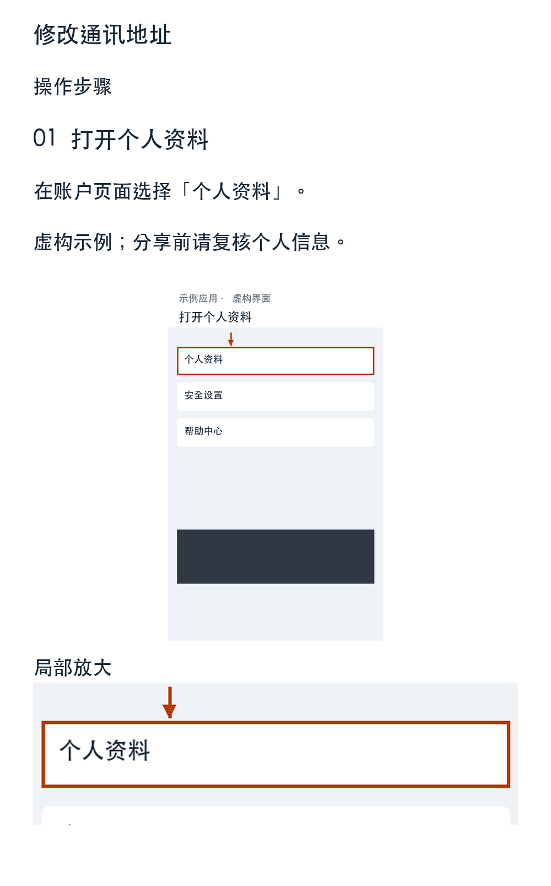

# screenshot-to-guide · 截图变教程

[English](README.en.md) · [技能入口](SKILL.md) · [示例](#已生成示例) · [测试记录](TESTING.md) · [MIT License](LICENSE)

把几张截图和一句“教我爸关闭消息通知”变成带标注的 PDF 或手机长图。面向父母、朋友、客户、同事和普通新手。用户不填坐标、不写 JSON；支持看图并执行本地脚本的宿主 Agent 负责理解截图和生成内部步骤数据。

**把你会做的操作，变成别人看得懂的教程。**

截图变教程是一个开源 Agent Skill。你提供截图、说清想教谁做什么，Agent 就会按截图顺序整理步骤、保留真实按钮名称、标出操作位置，生成可直接分享的 A4 PDF 或手机长图。它适用于教父母关闭通知、教朋友使用软件、向客户说明资料修改流程，以及为同事整理操作指引。

宿主 Agent 负责看图与教学判断，本地 Python 脚本负责验证、脱敏、裁剪、标注、排版和导出。最终用户不需要填写坐标、编写 JSON 或逐张编辑截图。

项目采用 MIT 许可。仓库根目录本身就是完整 skill；加载或安装由使用者选择，不会修改其他 Agent 的配置。

## 能做什么

- **按读者调整表达**：父母或不熟悉操作的人使用大字号、明确位置、单步动作；客户说明保持简洁专业；熟练用户减少基础解释。未指定时默认普通新手。
- **输出两种格式**：默认 PDF，可选 PNG 长图或两者；长图按完整步骤连续编号，不强行缩字塞进一张。
- **保留上下文与细节**：在原截图副本上添加框、箭头，小按钮和长页面可同时展示局部放大图，不用生成式绘图重画界面。
- **先脱敏，再导出**：Agent 识别无关个人信息和秘密，脚本实际替换对应像素；导出的 PDF 不携带原图或隐藏 OCR 文字层。
- **允许逐步修改**：可以要求字再大一点、改成繁体或详细解释某一步，再导出新版本；已有输出目录拒绝覆盖。
- **如实处理不完整证据**：缺图、顺序矛盾和看不清的按钮由 Agent 集中澄清，必要时输出明显标记的待补全草稿。

## 使用

先获取仓库：

```sh
git clone https://github.com/ChrisssTsui/screenshot-to-guide.git
cd screenshot-to-guide
```

让支持看图、skill 和本地脚本执行的 Agent 加载本目录的 [SKILL.md](SKILL.md)，附截图并说明目的，例如：

> 教我爸怎么关闭消息通知，字大一点。PDF 和手机长图都要。

也可说“教客户修改通讯地址”“改成繁体”“第二步再解释详细些”。默认普通新手风格、PDF。安装位置与加载方式由宿主决定；开发此项目不会更改其他 Agent 的配置。

本地依赖 Python 3.10+、Pillow、ReportLab，以及包含简体/繁体/英文的字体。可在独立虚拟环境安装：

```sh
python3 -m venv .venv
.venv/bin/python -m pip install -r requirements.txt
source .venv/bin/activate
# Linux 通常使用已安装的 Noto Sans CJK；其他位置可指定：
export GUIDE_FONT='/path/to/NotoSansCJK-Regular.ttc'
```

macOS 默认查找系统黑体；字体不随仓库分发，其授权由字体提供方决定。依赖不可安装时应明确报告环境限制。

## CLI / 开发验证

以下命令从项目根目录执行。示例 JSON 仅供开发和 Agent 参考，用户不用编辑。

```sh
python scripts/guide.py examples/parents/guide.json --validate
python scripts/guide.py examples/parents/guide.json --out output/parents-r01 --format both
python scripts/guide.py examples/customer/guide.json --out output/customer-r01 --format both
python -m pip install -r requirements-dev.txt
python -m unittest discover -s tests -v
```

输出目录必须不存在；反馈修改后用 `r02` 等新目录。图片路径相对 JSON 目录且不能越界。脚本不会覆盖输入或已有手改输出。内部结构详见 [数据规范](references/data.md)。

需要方向校正预览时：

```sh
python scripts/inspect_images.py screenshots/01.jpg screenshots/02.png --out private-preview
```

预览含未脱敏原内容，仅供 Agent 内部使用。交付只取导出目录中的 PDF/PNG；不要分享输入、内部 JSON、预览和工作目录。

## 已生成示例

| 示例 | 输入 | PDF | 手机长图 |
| --- | --- | --- | --- |
| 教父母关闭通知 | [4 张虚构截图和步骤](examples/parents) | [4 页 PDF](examples/parents/final/guide.pdf) | [01](examples/parents/final/guide-01.png)、[02](examples/parents/final/guide-02.png)、[03](examples/parents/final/guide-03.png)、[04](examples/parents/final/guide-04.png) |
| 教客户修改通讯地址 | [5 张虚构截图和步骤](examples/customer) | [5 页 PDF](examples/customer/final/guide.pdf) | [01](examples/customer/final/guide-01.png)、[02](examples/customer/final/guide-02.png)、[03](examples/customer/final/guide-03.png)、[04](examples/customer/final/guide-04.png)、[05](examples/customer/final/guide-05.png) |

<table>
<tr><th>教父母关闭通知</th><th>教客户修改通讯地址</th></tr>
<tr><td></td><td></td></tr>
</table>

截图由 `scripts/make_examples.py` 在本地绘制，仅含虚构资料；包含 EXIF 旋转图、长截图及电脑宽屏。重建脚本只针对这些仓库示例输入，勿用于用户工作目录。所有真实截图都应保留原样。

## 如何保证一致和隐私

同一数据先生成完整步骤卡片；PDF 和 PNG 使用相同卡片，不另排一套内容。每个 A4 页保留完整步骤，PNG 在步骤之间分段（每段最多 3000px），不靠缩小字号塞入长图。保留页面上下文，同时对小按钮提供局部图。

敏感区域先被替换为纯色像素，再裁剪、缩放、标注。PDF 只嵌入最终卡片，不嵌入原图、OCR 文字层、附件或批注。正文直接绘制为文本像素，HTML 字符不会执行。PDF 不可搜索、选择文字，也不适合依赖屏幕阅读器的使用场景。

宿主负责发现敏感信息、确认排序与教学语义；脚本不提供 OCR 或隐私自动识别。不使用外部视觉 API、图床或遥测，也不额外上传截图；不能据此保证宿主本身离线。**分享前请再复核个人信息。**

## 验证与限制

详见 [测试记录](TESTING.md)。坐标、边界、方向、重复截图警告、路径安全、分页、溢出拒绝、导出一致性和秘密残留有本地测试。PDF 已通过 Poppler 渲染，并查看全部页面及长图。

此 skill 不能保证任意宿主的看图质量；无可靠视觉能力时必须停止猜测。漏图、顺序矛盾、模糊文字和不完整成功证据由 Agent 提问或标记草稿处理。字体覆盖和手机实际显示效果取决于设备；当前验证为桌面图像预览，未在实体手机或打印机验证。文本超长会拒绝输出，需拆步骤或精简。单步一个完整页面是为避免图文分离的设计选择。

## 结构与工作方式

```text
截图 + 教学目的
       ↓
宿主 Agent：看图、判断读者、检查隐私与步骤、生成内部数据
       ↓
本地脚本：校验 → 方向校正 → 擦除敏感像素 → 标注/裁剪 → 排版
       ↓
同一组步骤卡片 → A4 PDF / 连续编号 PNG
       ↓
Agent 查看全部导出图及 PDF 渲染页，再交付可打开的文件
```

| 文件 / 目录 | 用途 |
| --- | --- |
| `SKILL.md` | 宿主 Agent 的技能入口与执行约束 |
| `references/data.md` | 内部数据格式与统一坐标规范 |
| `scripts/guide.py` | 校验和 PDF / PNG 导出 CLI |
| `scripts/inspect_images.py` | 仅供内部使用的方向校正预览 |
| `scripts/make_examples.py` | 虚构示例输入生成器 |
| `examples/` | 两套虚构输入、步骤数据、实际导出与视觉审阅图片 |
| `tests/` | 单元测试与中英繁体视觉测试产物 |
| `TESTING.md` | 已执行验证及已知限制 |

## 贡献

欢迎提交问题或改进。复现问题请使用虚构界面或彻底脱敏的截图，附上期望结果、实际结果、Python/依赖版本和执行命令；不要上传聊天、真实客户资料、验证码或其他凭据。

提交代码前运行上面的测试。涉及标注、字体、排版或导出的更改，还需渲染 PDF 并查看全部页面与 PNG，确认没有遮挡、截断或隐私残留。教学语义或宿主视觉行为的改动应补充实际截图场景验证。

## 许可

代码与本仓库虚构示例采用 [MIT License](LICENSE)。使用环境提供的字体遵循各自许可；仓库不包含系统字体。截图变教程只制作操作说明，不代登录、转账、交易或修改真实设置。
